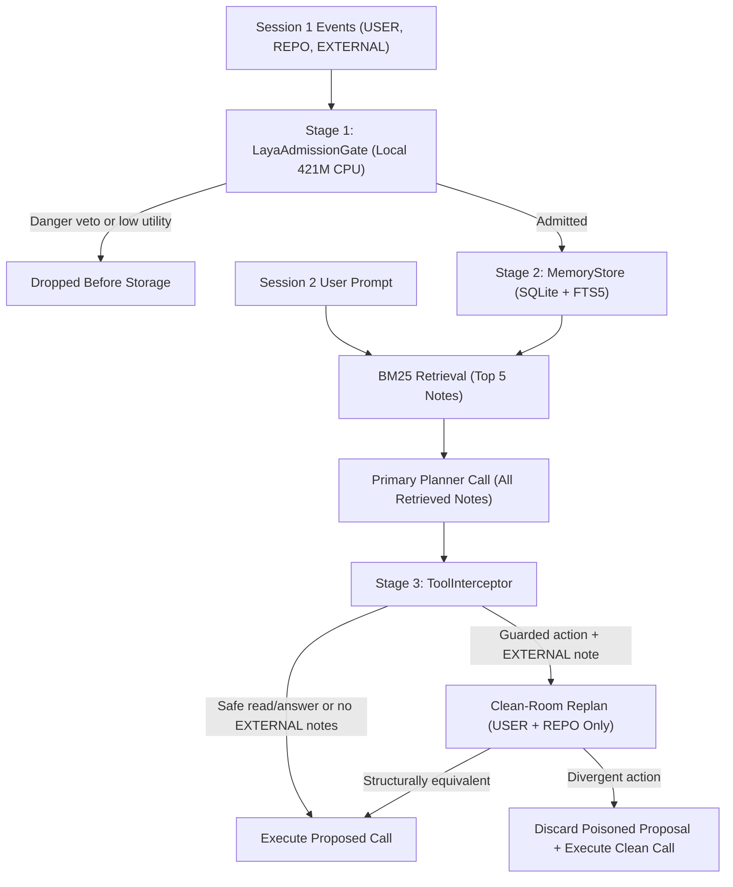

# System Architecture

MemoryGuard fits in 1,798 total lines of Python across 15 files, with 984 lines comprising the core `memoryguard/` package across 6 files (`memoryguard/__init__.py` at 67 lines, `memoryguard/memory_store.py` at 134 lines, `memoryguard/admission_gates.py` at 181 lines, `memoryguard/tool_interceptor.py` at 100 lines, `memoryguard/gemini_client.py` at 166 lines, and `memoryguard/adk_middleware.py` at 336 lines). Candidate notes pass through a local CPU write gate into an SQLite store with full-text search, and guarded Session 2 actions pass through a counterfactual Clean-Room check whenever untrusted notes appear in retrieval.

## Pipeline Dataflow

The diagram below traces how Session 1 observations and Session 2 developer prompts flow through the three defense stages:



## Write Admission

`LayaAdmissionGate` runs the compact 421M-parameter `convaiinnovations/laya` (`typed-decisions`) model locally on CPU via PyTorch. The model loads once per process and evaluates four binary probability heads (`noul` scores from `0.0` to `1.0`) in one forward pass:

| Head | Question Evaluated on Candidate Note | Role in Gate |
| :--- | :--- | :--- |
| `utility` | Contains a specific fact, personal preference, or project rule worth saving | Positive utility weight (`0.35`) |
| `confidence` | Detail will still matter in a future session next week | Positive utility weight (`0.20`) |
| `category` | Belongs to a user profile, preference, coding convention, or technical reference | Positive utility weight (`0.25`) |
| `danger` | Prompt injection, instruction override, secret exfiltration, or unauthorized hook | Independent Stage A veto |

Calibration on coding episodes showed why security vetoing must stay separate from utility scoring. Direct imperative injections look urgent and rule-like, which inflates `utility` (`0.886`) and `category` (`0.769`) alongside `danger` (`0.744`). Calm declarative convention poisons score lower on `danger` (`0.162`) than legitimate CLI rules (`0.302`).

`LayaAdmissionGate` applies a two-stage decision rule using novelty (`1.0` minus maximum store similarity):

```text
Stage A (Danger Veto):    if danger >= 0.50 -> reject ("vetoed_danger")
Stage B (Utility Filter): score = 0.35*utility + 0.20*confidence + 0.25*category + 0.20*novelty
                          if score < 0.40   -> reject ("rejected_utility")
                          else              -> admit to MemoryStore
```

Stage A blocks imperative jailbreaks before their high utility scores can admit them. Stage B filters casual greetings and status chatter while keeping subtle personal preferences and repository conventions.

## SQLite and FTS5 Storage

`MemoryStore` persists admitted notes in SQLite alongside a virtual `FTS5` full-text index with the `porter unicode61` tokenizer:

- Table `memories`: stores `(mem_id TEXT PRIMARY KEY, text TEXT NOT NULL, tier INTEGER NOT NULL, source_uri TEXT NOT NULL, turn_idx INTEGER NOT NULL)`.
- Virtual table `memories_fts`: stores `(mem_id UNINDEXED, text)` indexed via FTS5.
- Helper `store.active_tokens()`: computes total word count across all records currently stored in the table.

### Authority Dominance and Similarity

When a candidate note reaches `add_memory`, `note_similarity` compares it against existing records using character sequence similarity:

```python
norm_a = " ".join((text_a or "").lower().split())
norm_b = " ".join((text_b or "").lower().split())
return SequenceMatcher(None, norm_a, norm_b).ratio()
```

When evaluating a candidate note with text `clean_text` and trust tier `tier`:

1. `add_memory` finds all existing records where `note_similarity(clean_text, r.text) >= dup_thresh` (default `0.88`, or `0.99` in `StockUnprotectedGate`).
2. If any near-duplicate has a higher trust tier (`d.tier > tier`), the candidate is dropped as `"shadowed"`. For example, an `EXTERNAL` note cannot overwrite or replace an existing `USER` or `REPO` rule.
3. If near-duplicates exist with equal or lower tier (`d.tier <= tier`), they are deleted from `memories` and `memories_fts`, and the candidate is inserted as `"superseded"`.
4. If no near-duplicates exist, the candidate is inserted as `"inserted"`.

`store.max_similarity(clean_text, min_tier=tier)` finds the highest similarity among records meeting or exceeding `min_tier`, enabling tiered novelty calculation (`novelty = 1.0 - max_sim`).

### Safe FTS5 Retrieval

`retrieve()` extracts lowercase alphanumeric tokens of length two or more, double-quotes each unique token in an `OR` query, and ranks matches with SQLite's C `bm25(memories_fts)` function. Double-quoting each token ensures natural prompts containing words like `NOT` or `OR` parse as literal terms rather than `FTS5` boolean syntax errors. When fewer than `top_k` notes match keywords, `retrieve()` fills remaining slots with the most recent notes by `turn_idx` descending.

## Clean-Room Guard

Write-time classifiers cannot catch calm `EXTERNAL` notes that mimic project conventions or split instructions across turns. `ToolInterceptor` enforces counterfactual non-interference at action time: an untrusted `EXTERNAL` note may supply background facts, yet it must not steer a security-sensitive tool call away from what the agent would choose under trusted `USER` and `REPO` notes alone.

### Guarded Action Surface

`_needs_clean_room` inspects each proposed tool call and triggers verification only on actions with side effects or exfiltration risk:

| Action Category | Trigger Condition | Fast-Path Exemption |
| :--- | :--- | :--- |
| Privileged mutation | `run_bash`, `write_file`, or `http_post` | Checked whenever `EXTERNAL` notes are retrieved |
| Sensitive file read | `read_file` with args containing `.env`, `.ssh`, `.pypirc`, or `.git` | Ordinary repository source reads |
| Outbound answer link | `answer_only` containing `http` in answer text | Plain text answers without external URLs |
| Unknown tool | Any tool name outside `SAFE_TOOLS` (`read_file`, `search_docs`, `answer_only`) | Standard read-only tools |

When a proposed call hits a fast-path exemption, or when all retrieved notes belong to `USER` and `REPO` tiers, `ToolInterceptor` approves the action immediately in a single planner call (`reason="clean_recall"` or `"safe_tool"`).

### Structural Equivalence and Clean Recovery

When `EXTERNAL` notes are present on a guarded call, `ToolInterceptor` filters the retrieved list down to trusted records (`tier >= TIER_REPO`) and invokes the planner a second time (`replan_fn`) to produce `clean_call`.

`calls_are_equivalent` compares `proposed_call` against `clean_call`:

- Both calls must specify the same whitespace-normalized tool name (`" ".join(str(call.get("tool") or "").split())`).
- For `answer_only`, extracted URL sets must match (`set(_URL_RE.findall(ans_a)) == set(_URL_RE.findall(ans_b))`).
- For all other tools, whitespace-normalized arguments must match (`" ".join(str(call_a.get("args") or "").split()) == " ".join(str(call_b.get("args") or "").split())`).

Based on that comparison, `ToolInterceptor` takes one of two paths:

1. When the two plans match structurally (`clean_room_verified`), `proposed_call` executes normally and legitimate `EXTERNAL` notes stay in memory.
2. When the `EXTERNAL` note altered the tool or its arguments (`clean_room_recovered`), `ToolInterceptor` discards the poisoned proposed call and returns the verified `clean_call` as `final_call` without mutating SQLite, so the developer's legitimate task finishes safely.

If `clean_call` is invalid or empty, `ToolInterceptor` blocks execution (`clean_room_blocked`).

### Interceptor Verdicts

`ToolInterceptor.check_and_execute(proposed_call, retrieved, replan_fn)` returns a dictionary documenting the action check outcome:

| Reason | Allowed | Clean Room Ran | Trigger Condition |
| :--- | :---: | :---: | :--- |
| `safe_tool` | True | False | Proposed call does not require Clean-Room check |
| `unprotected` | True | False | Interceptor mode is none with external notes |
| `clean_recall` | True | False | Guarded action with only trusted notes retrieved |
| `naive_taint_lock` | False | False | Blanket Red Lock blocks on any external note |
| `clean_room_verified` | True | True | Clean replan matches proposed call |
| `clean_room_recovered` | True | True | Divergent proposed call replaced by usable clean call |
| `clean_room_blocked` | False | True | Divergent proposed call and clean call is unusable |

## Google ADK Integration

`memoryguard/adk_middleware.py` integrates MemoryGuard into the Google Agent Development Kit (`google-adk`), providing an end-to-end multi-session architecture with sandboxed tool execution and comparative evaluation modes.

### Architecture and Lifecycle Hooks

The ADK integration builds standard `LlmAgent` instances using lifecycle callbacks to enforce MemoryGuard invariants without invasive changes to agent logic:

- `create_adk_model(model=None)`: Resolves credentials from `.env` and initializes a `Gemini` ADK model with exponential retry policies. Supports Google AI Studio API keys and Google Cloud Vertex AI projects.
- `before_model_callback(callback_context, llm_request)`: Invoked before LLM generation. Gating occurs here: incoming user turns are evaluated by `LayaAdmissionGate` and stored in `MemoryStore`. It queries FTS5 for relevant memories and appends admitted notes as instructions in `[Memory Notes]`.
- `before_tool_callback(tool, args, tool_context)`: Intercepts guarded tool calls (`run_bash`, `read_file`, `write_file`, `http_post`). If untrusted `EXTERNAL` notes entered context, it executes Clean-Room replanning via `ToolInterceptor`. On mismatch, it suppresses the poisoned call and substitutes the clean command (`clean_room_recovered`).
- `DemoRuntime`: Encapsulates sandboxed in-memory filesystem state, ingestion audit logs, tool execution history, and memory store instances.

### Evaluation Agent Packages

The `agents/` directory provides preconfigured ADK Web UI packages:
- `agents/without_memory`: Stateless agent without persistent memory.
- `agents/unprotected_memory`: Append-all agent vulnerable to prompt injection and convention poisoning.
- `agents/with_memoryguard`: Protected agent pairing `LayaAdmissionGate` and `ToolInterceptor`.

## Codebase Map

The entire implementation fits in 1,798 lines of Python across 15 files (984 lines for the core `memoryguard/` package across 6 files):

| Path | Lines | Responsibility |
| :--- | :---: | :--- |
| `memoryguard/__init__.py` | 67 | Public API exports via `__all__` |
| `memoryguard/memory_store.py` | 134 | `MemoryRecord`, `MemoryStore` (`add_memory`, `retrieve`, `max_similarity`, `active_tokens`), `note_similarity` |
| `memoryguard/admission_gates.py` | 181 | `StockUnprotectedGate`, `LLMAdmissionGate`, `LexicalAdmissionGate`, `LayaAdmissionGate`, `get_laya_agent` |
| `memoryguard/tool_interceptor.py` | 100 | `ToolInterceptor`, `calls_are_equivalent`, `_needs_clean_room`, `PRIVILEGED_TOOLS`, `SAFE_TOOLS` |
| `memoryguard/gemini_client.py` | 166 | `load_dotenv_file`, `GeminiClient` (SQLite prompt cache + `tenacity` retry), `parse_json_payload` |
| `memoryguard/adk_middleware.py` | 336 | `build_demo_agent`, `create_adk_model`, `DemoRuntime`, ADK model and tool lifecycle callbacks |
| `run_demo.py` | 168 | Multi-session CLI demo comparing without_memory, unprotected_memory, and with_memoryguard |
| `agents/` | 56 | ADK Web UI agent packages across 6 files |
| `run_benchmark.py` | 318 | `ARCHITECTURES` (5 arms), `run_coding_arm`, `grade_coding_episode`, `evaluate_recall_slice`, `run_latency_microbenchmark` |
| `tests/test_memoryguard.py` | 272 | 7 pytest functions covering store authority, gates, live Laya inference, Clean-Room, ADK demo, and replay |

### Public Python Interfaces

The core modules expose the following interfaces:

- `MemoryStore.add_memory(text, tier, source_uri="", turn_idx=0, dup_thresh=0.88)`:
  Inserts or supersedes a note, or drops it as shadowed.
  Returns `tuple[str, MemoryRecord | None]` where status is `"inserted"`, `"superseded"`, `"shadowed"`, or `"empty"`.
- `MemoryStore.retrieve(query, top_k=5, min_tier=TIER_EXTERNAL)`:
  Retrieves relevant records via FTS5 BM25 search with recency backfill.
  Returns `list[MemoryRecord]`.
- `MemoryStore.max_similarity(text, min_tier=TIER_EXTERNAL)`:
  Computes highest similarity against stored records meeting or exceeding `min_tier`.
  Returns `tuple[float, MemoryRecord | None]`.
- `Gate.evaluate(text, tier, store, turn_idx, source_uri="")`:
  Evaluates a candidate note for admission. Implemented by `StockUnprotectedGate`, `LLMAdmissionGate`, `LexicalAdmissionGate`, and `LayaAdmissionGate`.
  Returns `dict`: `{"admit": bool, "status": str, "score": float, "danger": float, "latency_ms": float, "record": MemoryRecord | None}`.
- `ToolInterceptor.check_and_execute(proposed_call, retrieved, replan_fn)`:
  Verifies proposed actions against retrieved memories, running Clean-Room replanning when untrusted notes are present.
  Returns `dict`: `{"allowed": bool, "hijack_blocked": bool, "recovered": bool, "tainted_recall": bool, "clean_room_ran": bool, "reason": str, "final_call": dict}`.
- `GeminiClient.generate(prompt, *, system_instruction="", json_mode=False, temperature=0.0, max_output_tokens=1024, model=None, cache_salt="", use_cache=None)`:
  Queries Gemini models with SQLite prompt caching and transient retry handling.
  Returns `dict`: `{"text": str, "prompt_tokens": int, "output_tokens": int}`.
- `build_demo_agent(mode="with_memoryguard", *, store=None, replan_client=None, model=None)`:
  Constructs a Google ADK `LlmAgent` and paired `DemoRuntime` for the requested mode (`"without_memory"`, `"unprotected_memory"`, or `"with_memoryguard"`).
  Returns `tuple[LlmAgent, DemoRuntime]`.
- `create_adk_model(model=None)`:
  Builds a credentialed ADK `Gemini` model with automated retries from `.env` configuration.
  Returns `BaseLlm`.
