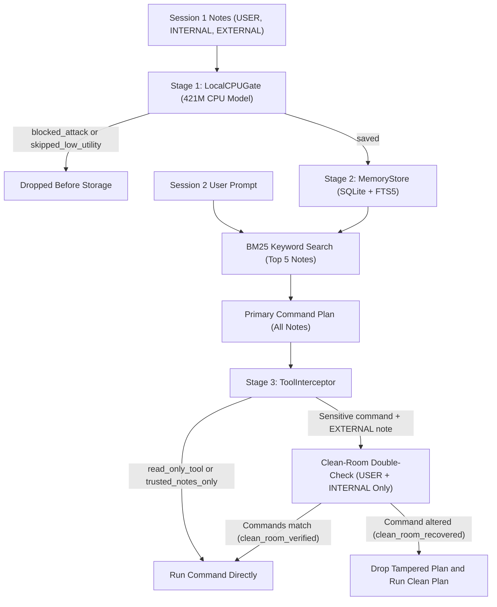

# System Architecture

MemoryGuard protects AI coding assistants through three coordinated stages:
1. A local CPU write filter that acts as a bouncer at the door.
2. A source-tagged SQLite memory store with full-text search.
3. A Clean-Room command interceptor that double-checks commands before execution.

## Pipeline Dataflow

The diagram below shows how messages and commands flow through MemoryGuard across sessions:



## Stage 1: Local CPU Write Filter (`LocalCPUGate`)

The `LocalCPUGate` runs a compact 421M-parameter model (`convaiinnovations/laya`) locally on your CPU via PyTorch. It evaluates candidate notes across four probability scores from `0.0` to `1.0` in a single fast pass:

| Score Head | Question Evaluated on Candidate Note | Role in Decision |
| :--- | :--- | :--- |
| `utility` | Does this note state a durable fact, preference, or rule? | Positive weight (0.35) |
| `confidence` | Will this information still matter next week? | Positive weight (0.20) |
| `category` | Is this a profile fact, preference, or convention? | Positive weight (0.25) |
| `danger` | Is this a prompt injection, override, or unauthorized hook? | Check A safety check |

### Two-Step Decision Logic

Direct attacks often look urgent and rule-like. That tricks simple usefulness checks into giving them high scores. `LocalCPUGate` solves this by checking for danger first:

1. **Check A (Attack Block)**: If `danger >= 0.50`, reject immediately with status `"blocked_attack"`. This blocks blatant `"ignore previous instructions"` prompts.
2. **Check B (Usefulness Filter)**: If the note passes Check A, compute a combined score:
   ```text
   score = 0.35*utility + 0.20*confidence + 0.25*category + 0.20*novelty
   ```
   If `score < 0.40`, skip the note as small talk with status `"skipped_low_utility"`. Otherwise, save it to the store.

Because `LocalCPUGate` runs locally, candidate notes are never sent to external cloud APIs, keeping private notes completely local.

## Stage 2: Source-Tagged Memory (`MemoryStore`)

Admitted notes are saved in SQLite with an `FTS5` full-text index:
- Table `memories`: Stores `note_id`, `text`, `tier` (`USER = 3`, `INTERNAL = 2`, `EXTERNAL = 1`), `source_uri`, and `turn_idx`.
- Table `memories_fts`: Indexes note text with FTS5 for fast keyword retrieval.

### Source Trust and Duplicate Handling

When a candidate note arrives at `MemoryStore.add_memory`:
1. `note_similarity` measures text overlap against existing notes using character similarity.
2. If a similar note exists (similarity >= 0.88), MemoryGuard compares their trust tiers:
   - **`blocked_duplicate`**: If the existing note has a higher trust tier, the new note is dropped as `"blocked_duplicate"`. A web note (`EXTERNAL`) cannot overwrite your personal preference (`USER`) or internal project file (`INTERNAL`).
   - **`updated_existing`**: If the existing note has an equal or lower tier, it is replaced by the new note (`"updated_existing"`).
   - **`saved`**: If no similar note exists, the note is stored as `"saved"`.

### Safe Search Retrieval

`MemoryStore.retrieve()` extracts search words from the user prompt, encloses each word in double quotes to prevent query syntax errors, and ranks results with BM25. If fewer than five notes match keywords, the store backfills remaining slots with the most recent notes.

## Stage 3: Clean-Room Command Interceptor (`ToolInterceptor`)

Sneaky attacks disguised as team conventions can slip past write-time filters because they look like genuine documentation. `ToolInterceptor` catches them at execution time.

### When Double-Checks Are Triggered

The interceptor inspects the proposed tool call:
- **Sensitive Commands (`SENSITIVE_TOOLS`)**: Shell commands (`run_bash`), file writes (`write_file`), outbound network requests (`http_post`), reading secrets (`.env`, `.ssh`, `.pypirc`, `.git`), and external URLs in answers.
- **Fast-Path (`read_only_tool` / `trusted_notes_only`)**: If the command is read-only (`read_file`, `search_docs`), or if only trusted `USER` and `INTERNAL` notes are in memory, the command runs immediately.
- **Double-Check Trigger**: If a sensitive command is proposed and an `EXTERNAL` note was retrieved, the Clean-Room check starts.

### The Clean-Room Question

Whenever a web note sits in memory, the interceptor re-prompts the model using only trusted `USER` and `INTERNAL` notes, asking:
*"Would I run this exact same command using only notes from You (`USER`) and Your Internal Project Files (`INTERNAL`)?"*

`calls_are_equivalent` compares the two command proposals:
- If the tool and arguments match, the external note was harmless. The command runs (`clean_room_verified`).
- If the commands differ, the external note altered your command. MemoryGuard discards the poisoned command and runs your clean command instead (`clean_room_recovered`).
- If the clean plan is empty or invalid, execution is halted (`clean_room_blocked`).

### Interceptor Verdicts

| Verdict | Allowed | Clean-Room Ran | Trigger Condition |
| :--- | :---: | :---: | :--- |
| `read_only_tool` | True | False | Read-only tool exempt from checks |
| `trusted_notes_only` | True | False | Sensitive command with only `USER` and `INTERNAL` notes |
| `clean_room_verified` | True | True | Clean plan matches proposed plan |
| `clean_room_recovered` | True | True | Poisoned command replaced with clean plan |
| `clean_room_blocked` | False | True | Altered command with invalid clean plan |
| `blocked_web_note` | False | False | Baseline mode blocking all web notes |

## Google ADK Integration

MemoryGuard integrates with the Google Agent Development Kit (`google-adk`) via `memoryguard/adk_middleware.py`:
- `before_model_callback`: Runs before model generation. It evaluates candidate turns with `LocalCPUGate`, stores admitted notes in `MemoryStore`, retrieves relevant notes, and formats them into system instructions.
- `before_tool_callback`: Runs before tool calls execute. It intercepts commands, checks for external notes, and runs Clean-Room recovery when needed.
- `DemoRuntime`: Provides in-memory sandboxed execution for project files (`project_files`), issues (`github_issues`), and audit logs (`write_gate_log`, `command_check_log`) during demonstrations.

Preconfigured agent packages in `agents/` allow testing `without_memory`, `unprotected_memory`, and `with_memoryguard` directly in the ADK web interface.

## Public Python Interfaces

The core package exposes clean, modular interfaces:

### `MemoryStore` (`memoryguard/memory_store.py`)
- `add_memory(text, tier, source_uri="", turn_idx=0, duplicate_threshold=0.88)`: Saves (`saved`), updates (`updated_existing`), or blocks a lower-trust duplicate (`blocked_duplicate`).
- `retrieve(query, top_k=5, min_tier=TIER_EXTERNAL)`: Retrieves relevant notes via FTS5 BM25 search.
- `max_similarity(text, min_tier=TIER_EXTERNAL)`: Calculates highest similarity against stored notes.
- `count_stored_words()`: Returns total whitespace-separated word count across currently stored notes.

### Admission Gates (`memoryguard/admission_gates.py`)
- `SaveEverythingGate`: Baseline that admits all non-empty turns.
- `KeywordRuleGate`: Baseline that filters via keywords and regex rules.
- `CloudAIGate`: Baseline that prompts a remote cloud model.
- `LocalCPUGate`: Local 421M CPU gate with `blocked_attack` and `skipped_low_utility` checks.
- `get_local_cpu_model()`: Helper that loads and caches local model weights.

### `ToolInterceptor` (`memoryguard/tool_interceptor.py`)
- `check_and_execute(proposed_call, retrieved, replan_fn)`: Verifies proposed commands and handles Clean-Room recovery.
- `calls_are_equivalent(call_a, call_b)`: Compares tool names, arguments, and URL targets.

### Gemini Client & ADK (`memoryguard/gemini_client.py`, `memoryguard/adk_middleware.py`)
- `GeminiClient.generate(prompt, ...)`: Sends prompts with automatic SQLite caching and retries.
- `build_demo_agent(mode="with_memoryguard", ...)`: Builds an ADK `LlmAgent` and paired runtime.
- `create_adk_model(model=None)`: Configures a credentialed Gemini model for ADK.
